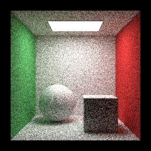

# Programming Assignment 3 — Path Tracing and BVH

## Due date: 14 December 2026, 23:59 HKT (UTC+8)

## Goal and marks

Build a CPU path tracer that renders a **Cornell box** to a **PPM image**, and
accelerate ray intersection queries with a **bounding volume hierarchy (BVH)**.
This is a four-week assignment with an expected workload of **24–32 hours**,
excluding unattended rendering time. The required work totals **100 marks**.
Perfect mirror reflection is an optional **5-mark bonus**.

| Part | Student implementation | Marks |
| --- | --- | ---: |
| 1. Ray intersections | Sphere and triangle intersection | 20 |
| 2. Monte Carlo sampling | Cosine-weighted hemisphere sampling | 15 |
| 3. Diffuse path tracing | Emission, indirect illumination, and path termination | 50 |
| 4. BVH acceleration | AABB intersection | 10 |
| 5. Verification | Rendered results and a short correctness/performance summary | 5 |
| Bonus. Perfect mirror | Ideal specular reflection | +5 |

The required renderer uses Lambertian surfaces and an emissive ceiling rectangle.
It should show soft shadows, indirect illumination, and red/green color bleeding.
GPU programming, texture mapping, mesh loading, refraction, explicit light
sampling, multiple importance sampling, and advanced BVH splitting are not
required. Visible Monte Carlo noise is expected at the submission settings.

## Get the latest assignment

Run from the repository root `COMP3271_Computer_Graphics`. First stash your local
changes, then pull to get the latest assignment files:

```shell
git stash
git pull
```

If you stashed changes, restore them afterwards with `git stash pop`. Resolve
any conflicts before continuing. Note that `git stash` does not include untracked
files by default; use `git stash -u` if you also need to stash those files.
Rebuild after pulling updates or editing C++ files.

## Build and run

Use a C++20 compiler and standard library with `std::format` support (for example,
GCC 13+, Visual Studio 2022 17.2+, or Apple Clang 15+/Xcode 15+). xmake manages
`argparse` for command-line parsing and `spdlog` for logging.

Run from the repository root `COMP3271_Computer_Graphics`:

```shell
xmake f -m release
xmake -y assignment3
xmake run assignment3 --width 64 --height 64 --spp 8
```

This quick run writes `outputs/cornell.ppm`. The program runs offline on the CPU
without an OpenGL window or a GPU. Open the PPM file with an image viewer that
supports PPM. The writer creates the output directory when necessary; reusing an
output path overwrites the previous image. Console messages go to stderr.

**The default is `--accel brute`: no acceleration structure.** The supplied linear
intersection loop lets you develop Parts 1–3 before implementing AABB intersection. The
starter compiles and writes an image, but the unimplemented student tasks produce
a black image initially. Implement primitive intersections for geometry previews,
then sampling and path tracing for a lit image. Enable `--accel bvh` after Part 4
is ready. Both modes must use the same integrator.

If you only need this CPU assignment and want to avoid configuring earlier
assignments' graphics packages, configure and build from inside `Assignment3`:

```shell
cd Assignment3
xmake f -m release
xmake -y assignment3
xmake run assignment3 --width 64 --height 64 --spp 8
```

The target still runs in the repository root, so relative output paths are the
same in both workflows. Configure from the chosen directory; do not configure
another project with `-P` in the same build directory. The commands below work
from either configured project directory.

## Command-line tutorial

### Choose rendering settings

Arguments after `xmake run assignment3` are passed to the renderer. Show all
options with:

```shell
xmake run assignment3 --help
```

| Option | Default | Meaning |
| --- | --- | --- |
| `--scene NAME` | `cornell` | `cornell`, `cornell_stress`, or `cornell_mirror` |
| `--accel MODE` | `brute` | `brute`: no acceleration; `bvh`: supplied BVH using your AABB intersection |
| `--width N`, `--height N` | `256` each | Image dimensions, each in `1..16384` |
| `--spp N` | `128` | Camera samples per pixel, in `1..1000000`; more samples reduce noise |
| `--depth N` | `8` | Maximum scattering events, in `0..1024` |
| `--seed N` | `3271` | Nonnegative 64-bit random seed for reproducible runs |
| `--output PATH` | `outputs/cornell.ppm` | Output PPM path, relative to the repository root |
| `--preview MODE` | `radiance` | `radiance`, `normal`, or `depth` |
| `--check` | Off | Run public correctness checks instead of rendering |
| `--benchmark` | Off | Compare brute force and BVH instead of rendering |
| `--rays N` | `10000` | Benchmark ray count, in `1..10000000` |
| `-h`, `--help` | Off | Print usage and exit |

Use small dimensions and low spp while developing. To render the required scene
with the supplied brute-force loop after completing Parts 1–3:

```shell
xmake run assignment3 --scene cornell --accel brute --width 256 --height 256 --spp 128 --depth 8 --seed 3271 --output outputs/cornell_brute.ppm
```

### Inspect intersections

After implementing Part 1, render geometry previews without needing the sampler,
path tracer, or BVH:

```shell
xmake run assignment3 --preview normal --spp 1 --output outputs/normals.ppm
xmake run assignment3 --preview depth --spp 1 --output outputs/depth.ppm
```

Normal colors show surface orientation. The depth view displays the camera-hit
distance divided by 8; misses are black. Both previews use the supplied gamma
conversion. These commands omit `--accel`, so they use brute force by default.

### Enable and verify the BVH

After completing Part 4, explicitly select BVH and compare with brute force using
the same scene, resolution, spp, depth, and seed:

```shell
xmake run assignment3 --scene cornell --accel bvh --width 256 --height 256 --spp 128 --depth 8 --seed 3271 --output outputs/cornell_bvh.ppm
xmake run assignment3 --check
xmake run assignment3 --benchmark --scene cornell_stress --rays 10000 --seed 3271
```

`--check` and `--benchmark` are mutually exclusive. Both exercise brute force and
BVH regardless of `--accel`, so BVH checks are expected to fail until Part 4 is
implemented. The benchmark defaults to `cornell_stress` when `--scene` is omitted;
use a Release build for performance comparisons.

### Render submission images

Once the required implementation is complete, generate the two required images
with BVH explicitly enabled:

```shell
xmake run assignment3 --scene cornell --accel bvh --width 256 --height 256 --spp 16 --depth 8 --seed 3271 --output outputs/cornell_16.ppm
xmake run assignment3 --scene cornell --accel bvh --width 256 --height 256 --spp 128 --depth 8 --seed 3271 --output outputs/cornell_128.ppm
```

For the optional mirror bonus, after implementing mirror reflection:

```shell
xmake run assignment3 --scene cornell_mirror --accel bvh --width 256 --height 256 --spp 128 --depth 8 --seed 3271 --output outputs/mirror.ppm
```

## Code template

The framework supplies C++20 vector/ray/material types, a pinhole camera with
pixel jitter, seeded random number generation, scene construction, a brute-force
closest-hit implementation, primitive bounding boxes, image accumulation, a PPM
writer, and correctness/benchmark drivers. Students implement only the marked
regions in `Hittable.cpp`, `Sampling.cpp`, `PathTracer.cpp`, and `BVH.cpp`.
Constructing the Cornell box, parsing arguments, logging, and writing the image
file are provided infrastructure.

This 128-spp reference preview uses the required settings. Noise is expected;
compare transport behavior rather than individual random pixels.



## Scene and rendering conventions

The supplied `cornell` scene uses right-handed, Y-up coordinates. The room spans
`x = [-1,1]`, `y = [0,2]`, and `z = [0,2]`, with an open front at `z = 0`.
The camera is at `(0,1,-3.2)`, looks at `(0,1,1)`, and has a vertical field of
view of 40 degrees. At a square aspect ratio it shows the room and its light.

| Element | Geometry and material |
| --- | --- |
| Red wall (`x = -1`) | Red diffuse, reflectance `(0.65,0.05,0.05)` |
| Green wall (`x = 1`) | Green diffuse, reflectance `(0.12,0.45,0.15)` |
| Floor, ceiling, back wall | White diffuse, reflectance `(0.73,0.73,0.73)` |
| Ceiling light | Two triangles at `y = 1.99`, `x = [-0.5,0.5]`, `z = [0.6,1.4]`; emits downward with radiance `(12,12,12)` |
| Short box | White diffuse; bounds `(-0.75,0,0.45)` to `(-0.15,0.6,1.05)`; 12 triangles |
| Sphere | White diffuse; center `(0.4,0.4,1.35)`, radius `0.4` |

Each room surface is represented by two triangles. The default scene is fixed
for assessment. Additional scenes are welcome but do not replace this scene.

Keep the following conventions throughout the implementation:

- A ray is `r(t) = origin + t * direction`. Intersection routines must work even
  when the direction is not unit length. Camera and scattering rays are normalized.
- A successful primitive query returns the nearest hit in the inclusive interval
  `[t_min,t_max]`, with position, unit normal, material, and stable primitive ID.
  On failure, leave the output record unchanged.
- Triangles are intersected from both sides. The geometric outward normal comes
  from vertex winding. The provided hit-record helper sets `front_face` and orients
  the shading normal against the incident ray. Only the light's front face emits.
- Use the supplied `ray_epsilon = 1e-4`. Offset each scattered ray origin by
  `ray_epsilon * normal` and query with `t_min = ray_epsilon`.
- A missed ray sees a black background. There is no ambient term or sky light.
- Accumulate and average radiance in linear RGB. The supplied writer applies
  `sqrt(max(0, channel))` after averaging, clamps to `[0,0.999]`, and converts to
  integer RGB `[0,255]`. This is the assignment's gamma-2 display approximation.
  Do not apply gamma inside the path tracer or clamp individual samples.
- Output is ASCII PPM (`P3`), with header `P3`, `width height`, and `255`, followed
  by RGB integers. Pixels are stored from the top row to the bottom row.

## Part 1 — Ray intersections (20 marks)

Implement `Sphere::Hit` and `Triangle::Hit` in `Hittable.cpp`, keeping the starter's
function signatures. Each takes a ray, an allowed `t` interval, and a hit record.

For a sphere, solve the quadratic and select the nearest valid root. Handle rays
that start inside the sphere, tangent rays, and cases where only the second root
is inside the interval. For a triangle, use Möller–Trumbore intersection or an
equivalent barycentric method. Reject parallel rays and degenerate triangles;
accept valid edge and vertex hits. Populate the record through the provided helper.

**Check:** inspect the supplied normal/depth debug views. Objects should have
complete silhouettes, correct depth ordering, and no missing back-facing surfaces.
The brute-force path must work before you depend on the BVH.

## Part 2 — Cosine-weighted hemisphere sampling (15 marks)

Implement `SampleHemisphere` in `Sampling.cpp`. Given a unit shading normal and
the supplied RNG, return a unit direction in its hemisphere. Use two independent
uniform random values in `[0,1)` and construct a local orthonormal basis robustly,
including normals close to any coordinate axis.

The required probability density over solid angle is:

```text
p(omega) = max(0, dot(normal, omega)) / pi
```

Do not use uniform hemisphere sampling with the cosine-weighted throughput rule
from Part 3: the resulting estimator would be incorrect. Use only the supplied
RNG so a fixed seed can reproduce a run.

**Check:** sampled directions have length approximately 1 and nonnegative dot
product with the normal. Over many samples, the average of `dot(normal, omega)`
approaches `2/3`; the average tangential components approach zero.

## Part 3 — Diffuse path tracing (50 marks)

Implement `TracePath` in `PathTracer.cpp`, using either recursion or iteration.
For each camera sample, trace the ray through the scene, collect emitted radiance,
and continue paths at diffuse surfaces with the sampler from Part 2.

For a Lambertian material with reflectance `rho`, the BRDF is `rho / pi`. A
one-sample Monte Carlo estimate of the reflected radiance is:

```text
L_reflected = (rho / pi) * L_next * max(0, dot(normal, omega)) / p(omega)
```

With cosine-weighted sampling, the BRDF/cosine/PDF factor simplifies to `rho`.
Color multiplication is component-wise. Track this attenuation at every bounce;
do not add a separate ambient, Phong, or inverse-square attenuation term.

Required behavior:

1. On a miss, contribute black and terminate the path.
2. On an emissive surface, contribute its radiance only on the emitting side and
   terminate. The supplied light has zero diffuse reflectance; its back is black.
3. On a diffuse surface, sample one outgoing direction, multiply path throughput
   by its reflectance, and continue with the offset ray.
4. `--depth D` permits at most D diffuse scattering events. The initial camera
   query still occurs at depth 0. After the Dth scatter, query the resulting ray
   for emission, but do not scatter again. Thus depth 0 shows only directly
   visible emission, depth 1 can illuminate diffuse surfaces, and greater depths
   add indirect illumination.

A fixed depth limit is sufficient. Russian roulette and explicit light sampling
are not needed. The provided render loop averages `--spp` jittered camera samples
per pixel; do not count indirect rays as additional camera samples.

**Check:** the light remains visible at depth 0. Increasing the depth from 1 to 8
adds illumination in indirectly lit regions and red/green bleeding on white
surfaces. Increasing samples per pixel reduces noise without systematically
changing brightness. An 8-spp preview may contain many dark pixels.

## Part 4 — BVH acceleration (10 marks)

Implement only `AABB::Hit` in `BVH.cpp`. BVH construction (`BVH::Build` and
`BVH::BuildRange`) and closest-hit traversal (`BVH::Hit` and `BVH::HitNode`)
are supplied, along with bounds helpers, node storage, primitive IDs, and the
brute-force baseline. The supplied BVH uses your AABB intersection to accelerate
all scene queries, including secondary path rays.

### Ray–AABB intersection (10 marks)

Use the slab method and intersect each axis interval with `[t_min,t_max]`.
Account for negative direction components. When a component is zero, reject only
if the origin is outside that axis's slab; otherwise that axis imposes no new
restriction. Avoid division by zero and NaNs. Keep a touching interval as a hit
(`t_exit >= t_enter`), including flat boxes from triangle bounds. Empty bounds
and reversed input intervals (`t_min > t_max`) must return false.

**Check:** the supplied checker tests AABB edge cases and compares brute-force
and BVH hit/miss results, distances, normals, and materials on fixed rays. With
the same per-pixel seeds, both render modes should agree within floating-point
tolerance.

The default Cornell box is deliberately small; use `cornell_stress` for the
performance comparison. It keeps the room and light but replaces the interior
objects with a deterministic grid of **4,096 small spheres**. The benchmark below
uses **10,000 fixed primary rays** and counts AABB and primitive tests separately.

```shell
xmake run assignment3 --check
xmake run assignment3 --benchmark --scene cornell_stress --rays 10000 --seed 3271
```

The benchmark automatically runs each accelerator three times and prints the
median query time, one-run counters, construction time, and speedup ratios.
The optional mirror check does not affect the required checker exit status.
The deterministic sampling check uses 50,000 samples for each of eight normals,
with absolute tolerances 0.012 on the two cosine moments and 0.015 on the
tangential mean magnitude. It is a diagnostic rather than proof of the full PDF.
No fixed wall-clock speedup is required: hardware varies, and correct primitive-test
reduction provides the main evidence of acceleration.

## Bonus — Perfect mirror reflection (+5 marks, optional)

Add an ideal mirror branch to `TracePath` using the supplied mirror material flag.
Reflect the incident unit direction about the shading normal, offset the new ray
origin, and multiply throughput by the mirror reflectance. Do not apply a diffuse
cosine or PDF to this deterministic delta reflection. Count each mirror event
toward the same scattering limit.

Use the supplied `cornell_mirror` variant, which changes only the sphere to a
mirror with reflectance `(0.95,0.95,0.95)`. Submit `mirror.ppm` and describe the
change in the summary. The diffuse required scene and its marking remain
independent of the bonus.

## Suggested four-week schedule

| Week | Milestone | Estimated active work |
| --- | --- | --- |
| 1 | Primitive intersections; inspect normal/depth previews | 6–8 hours |
| 2 | Cosine sampler and diffuse path tracer; render with brute force | 10–13 hours |
| 3 | AABB intersection; verify the supplied BVH against brute force | 4–5 hours |
| 4 | Correctness checks, benchmark, final PPMs, and short summary | 4–6 hours |

These are suggested milestones, not separate submission deadlines. Start with
small images and low spp; reserve high-spp rendering for the final week. You do
not need a denoiser, a high-end CPU, or a noise-free image for full required marks.

## Requirements and submission

Keep the provided interfaces and scene constants. Implement the assessed
algorithms yourself; do not call a rendering engine, ray-intersection library,
or third-party BVH builder. Standard C++ containers, algorithms, and the supplied
vector helpers are allowed. Add concise comments explaining the sampling weight,
termination convention, and BVH building process.

Submit one archive named `Assignment3_<student_id>.zip` to Moodle before
**14 December 2026, 23:59 HKT (UTC+8)**, containing:

- `Hittable.cpp`, `Sampling.cpp`, `PathTracer.cpp`, and `BVH.cpp`;
- any additional source/header files you changed, retaining relative paths;
- `outputs/cornell_16.ppm` and `outputs/cornell_128.ppm`, both at **256 × 256**,
  with **16 and 128 spp** respectively, **depth 8**, **seed 3271**, and BVH enabled;
- `summary.md`, at most **500 words** excluding tables: explain the cosine-sampling
  weight and BVH building process, compare the two noise levels, state checker results,
  and give the benchmark table below;
- if attempting the bonus, `outputs/mirror.ppm` at 256 × 256, 128 spp, depth 8,
  seed 3271, plus a brief bonus description within the same summary.

For the benchmark, use a Release build. The driver uses one CPU thread for both
modes and reports the median query time from three runs of the same fixed ray
set. Copy the printed table and give CPU/compiler details. Counts are for one
run and are deterministic.

| Mode | Primitive tests | AABB tests | Median query time (ms) | Build time (ms) |
| --- | ---: | ---: | ---: | ---: |
| Brute force | | 0 | | N/A |
| BVH | | | | |

Report primitive-test reduction as `brute primitive tests / BVH primitive tests`
and time speedup as `brute query time / BVH query time`. Record any failed checks
honestly; partial implementations can earn marks for working components.
Do not submit executables, build directories, unmodified framework files, or
external assets. PPM files are required; screenshots do not replace them.

## References

- [Ray Tracing in One Weekend series](https://raytracing.github.io/): background on ray tracing, materials, and BVHs. Use the conventions and interfaces in this handout when they differ.
- [Cornell Program of Computer Graphics](https://www.graphics.cornell.edu/online/box/): background on the Cornell box. This assignment uses the simplified scene specified above.
